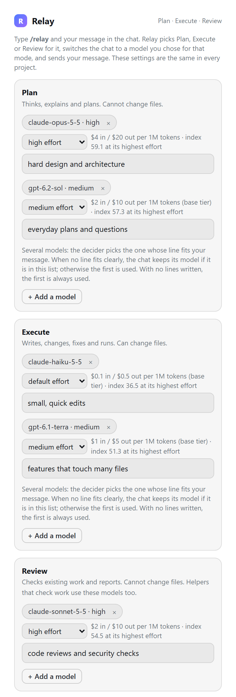
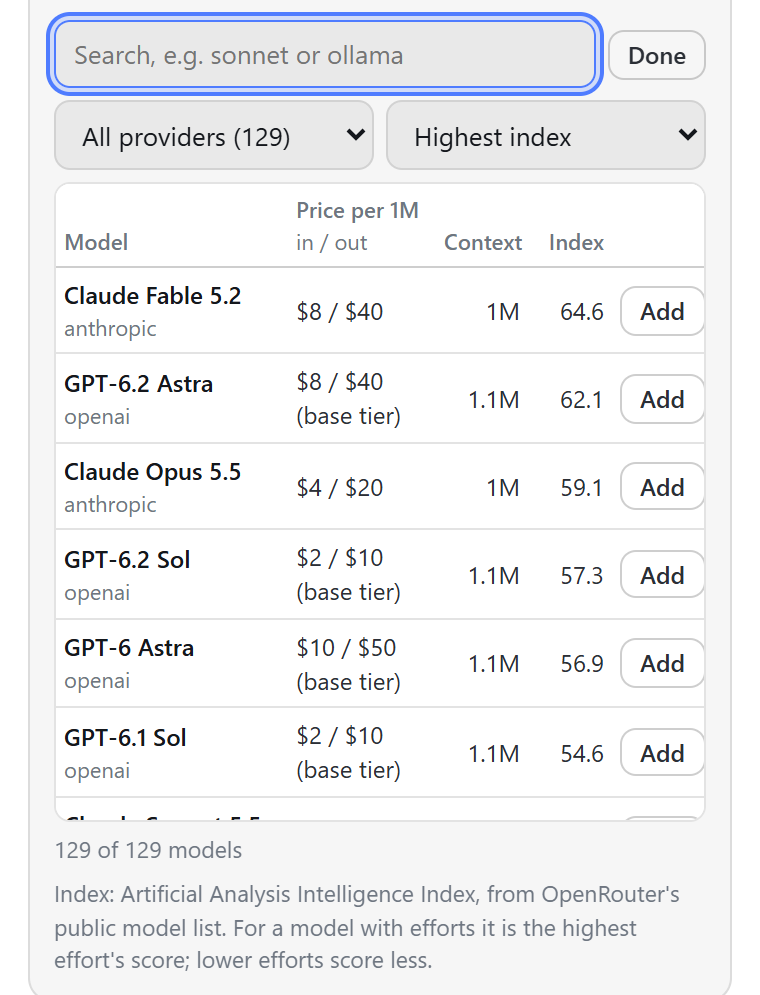
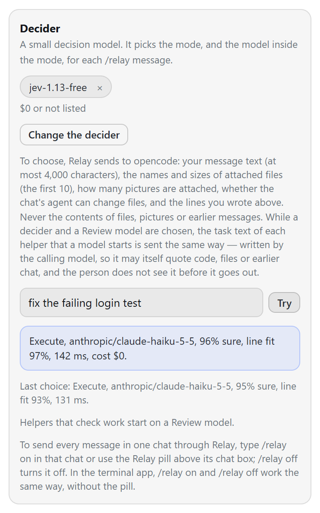
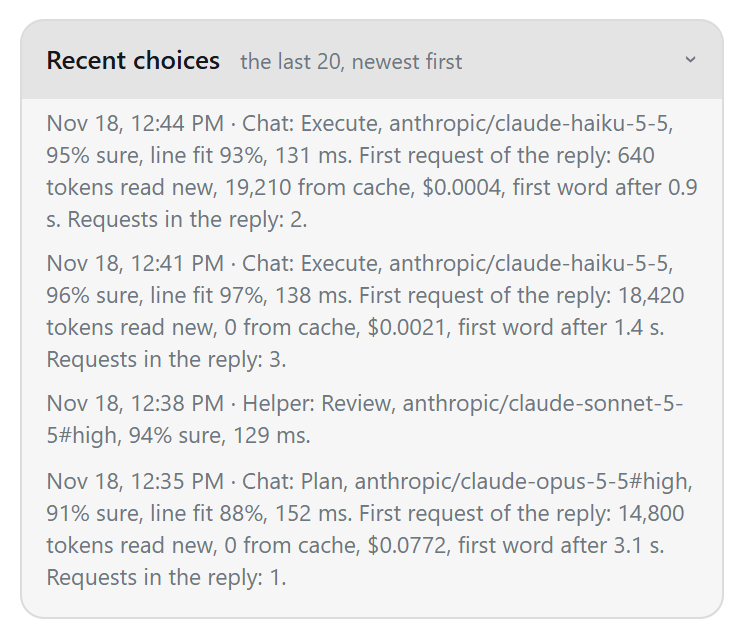

# Relay guide

What the [README](../README.md) leaves out: installing from source, each setting in the panel, how Relay behaves in a chat, and what to do when the panel is missing.

## Install from source

You need OpenCode 2.3.0 (Desktop or the terminal app), and Node.js 24 with npm and git to build Relay.

1. Get Relay and build it:

   ```sh
   git clone https://github.com/AsadKhalil/relay-opencode.git
   cd relay-opencode
   npm ci
   npm run build
   ```

2. Tell OpenCode to load it. Open OpenCode's global config file, `~/.config/opencode/opencode.json` (on Windows, `C:\Users\<you>\.config\opencode\opencode.json`; create it if it does not exist), and add the folder you cloned to `plugins`:

   ```json
   {
     "plugins": ["/full/path/to/relay-opencode"]
   }
   ```

   On Windows, write the path with forward slashes, for example `"C:/Users/you/code/relay-opencode"`. Keep any plugins that are already in the list.

3. Restart OpenCode. (Desktop usually picks up a change to this file by itself within a minute.)
4. Check: type `/` in a chat. `/relay` should be in the list.

To update later: `git pull`, `npm ci`, `npm run build`, then restart OpenCode.

## Set up

Open a chat, open the command palette (Ctrl+K) and run **Open Relay**. The Relay panel opens beside the chat. The settings are shared by all your projects. The terminal app has no settings screen, so set them up in Desktop.



### Models for each mode

Add models to **Plan**, **Execute** and **Review**: press **+ Add a model** under a mode.



- A table lists the models OpenCode offers you, with the price per million tokens (input / output), the context size and the intelligence index.
- Type in the search box to find one by its name or its provider, narrow the table to one provider, or sort it by price (cheapest first), by context (largest first) or by index (highest first). Press **Add** on a row.
- Each chosen model has a menu for its effort (low, high and so on) when the model offers them.
- The prices come from OpenCode's own model catalog, which OpenCode fills from [models.dev](https://models.dev); Relay asks nothing of its own. "not listed" means OpenCode has no price for that model (on 17 Nov 2026 every model of the `claude-agent` provider), and "$0 or not listed" means the catalog says 0, which can be either.
- The index is the Artificial Analysis Intelligence Index, taken from OpenRouter's public model list. For a model with efforts, it is the score at its highest effort, and a lower effort scores less (GPT-6.2 Sol: 57 at max, 41 at low). The price per token is the same at every effort, but a higher effort writes more tokens, so each reply costs more. "—" means Relay could not match the model. Hover over a number to see which model it came from. See [data sources](data-sources.md).
- When a mode has more than one model, write a short "use it for" line for each, for example "hard design and architecture" or "small, quick edits". The decision model matches your message to these lines. It never sees model names or prices.

### The decider



- Press **+ Choose a decider** and **Use** on a row. The table lists only the decision models OpenCode offers you; `opencode/jev-1.13-free` is free.
- **Change the decider** opens it again, and × removes the decider. Until you choose one, the panel and the pill warn you: without a decider, Relay switches nothing.
- Type a sample message in the test box and press **Try** to see what Relay would pick.

### Usage by model

**Usage by model** in the panel adds up every message Relay placed, with `/relay` or in a chat with Relay on, for each model and effort. It counts from the version that brought it onward.

- **Requests and tokens:** the requests the replies made, and their tokens: in, out, reasoning, read from a cache and written to a cache.
- **Cost by price:** each kind of token times its price for a million tokens, and the total. Reasoning is priced as output. The prices are OpenCode's own when it lists them, which is what you pay; otherwise Artificial Analysis's, marked `*`, once you have saved a key (below).
- **OpenCode's own cost**, when it is more than $0.

In OpenCode's terminal app, `/relay-stats` shows the same table in a dialog.

### Prices from Artificial Analysis

OpenCode lists no price for some models, such as Claude through a subscription login. For those, Relay can take each model's prices (in, out, cache read and cache write) and its intelligence index from Artificial Analysis, with a free key from [artificialanalysis.ai](https://artificialanalysis.ai/). Paste the key under **Prices from Artificial Analysis** in the panel and press Save; Remove deletes it.

- Relay downloads Artificial Analysis's free model list at most once a day. That is four of the 100 requests a day the free key allows.
- With a key saved, the model tables show Artificial Analysis's own index.
- Artificial Analysis lists one price for each model, so a higher price for long chats is not there.
- Its data is credited wherever Relay shows it.

### Recent choices



**Recent choices** at the bottom of the panel lists the last 20 decisions, for chats and helpers, and updates by itself. Once the chat has answered a message, its row also says what the reply took:

- **The reply:** the model and effort that answered, how many requests the reply made, and all of them added up: tokens in, out, reasoning (when there is any), read from a cache and written to a cache, with the cost OpenCode worked out (when the model has a listed price).
- **Prices:** that model's listed prices for a million tokens: in, out, cache read and cache write, at the size of the reply's first request. "$0 or not listed" means OpenCode has no price for it, as for Claude through a subscription login.
- **First request:** the tokens it read new (in, and written to a cache), the tokens it read from a cache, its cost, and the seconds until the first word. A switch to another model shows up there as a large "read new" number.

A row kept before 19 Nov 2026 has no model, totals or prices, only the number of requests and the first request.

The screenshots show the panel with example settings and example rows. The models, prices and index numbers are what OpenCode and Relay listed on 18 Nov 2026.

## Use

| You type | What happens |
|---|---|
| `/relay <message>` | Relay picks the mode and the model for this one message, switches the chat, and sends it. |
| `/relay on` | Every message you send in this chat goes through Relay, without typing `/relay`. |
| `/relay off` | This chat goes back to normal. |
| `/relay-stats` | In the terminal app: shows Usage by model in a dialog. |

- In Desktop, the **Relay pill** above the chat box shows whether Relay is on for that chat. Click it to turn Relay on or off there, and to see the last choice. With no decider chosen it reads **Relay on · no decider**, and its menu opens the Relay panel.
- OpenCode shows a "Switched to …" line in the chat when Relay changes the model, and Desktop's model picker follows Relay's choice.
- Plan and Review use OpenCode's `plan` agent, which is meant for reading and planning, not editing. Only Execute uses `build`, which can change files.
- When the decision model is not sure (under 60%), `/relay` uses Plan. With `/relay on`, the chat stays as it is.
- In a long chat, a move to a cheaper model of the same mode is made only when it pays, and a model the chat no longer fits is not used. See [When Relay saves money](saving-money.md).
- When a model starts a helper (an OpenCode subagent) to check work, Relay gives that helper your Review model, even if the model that starts it asked for another one, and rules that make a review end: a verdict every time, and at most three checks.
- In the terminal app, `/relay`, `/relay on` and `/relay off` work the same way. There is no pill there, and `/relay on` prints nothing.

## If Open Relay is missing

It shows only while a chat is open. Then check Settings → Extensions → Plugins: `relay-opencode` should be listed with **Reload** and a switch. If that list stays empty, or Desktop says it can't reach your computer, OpenCode's background service is not running properly and Desktop shows no plugin panels. Quit Desktop, end `opencode-cli.exe` (the one started with `serve --service`) in Task Manager, and start Desktop again.
